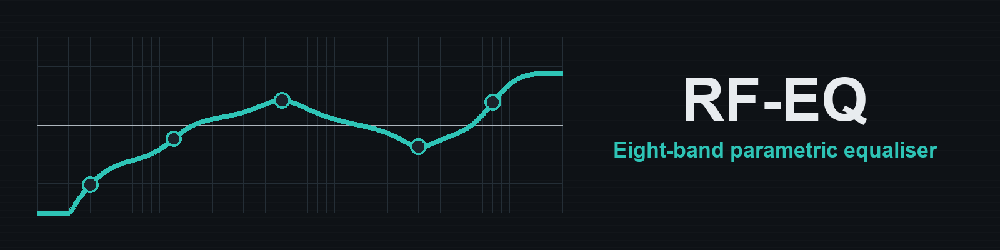

# RF-EQ

RF-EQ is an eight-band stereo equaliser for RackForge. Use it to clear rumble, soften a bright sound or bring out the part of an instrument that needs to come forward.

## Install

RF-EQ is included in the RackForge Standard bundle. To install it separately, download `RF-EQ.rfplugin` and choose **Install plugin** in RackForge's **Plugin Manager**. [Download RF-EQ](https://github.com/kalexis1994/rackforge-plugin-rf-eq/releases/latest)

## Start with a preset

Open the instrument's **Effects** in PLAY and choose **Add effect → RF-EQ**. Choose **Flat** to start from scratch, **Rumble Cut** to roll off the lowest frequencies, **Piano Air** for a brighter piano, or **Warm** for a gentler top end.

## Shape the sound

The graph shows how the active bands combine. Move a node on the graph or use the corresponding control strip. Move a bell or shelf sideways to change its frequency and up or down to boost or cut.

| Band | What to try |
| --- | --- |
| **High-pass** | Raise the cutoff until the low rumble clears, then listen to the lowest notes you want to keep. |
| **Low and high shelves** | Adjust the body or the air across a broad part of the sound. |
| **Four peak bands** | Sweep to find a frequency, then cut or boost it. A higher **Q** makes the affected area narrower. |
| **Low-pass** | Lower the cutoff to soften the very top of the sound. |

Use **Output** to match levels when comparing with **Bypass**, especially after several boosts or cuts.

## License

RF-EQ is distributed under GPL-3.0-only. [License](LICENSE) · [Notices](NOTICE.md)
